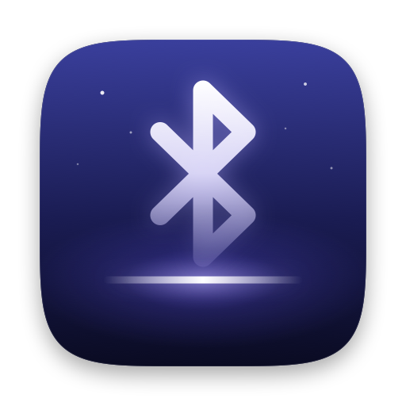

<p align="center"></p>

<h1 align="center">Hush</h1>

<p align="center">Close the lid, Bluetooth goes quiet. Open it, everything reconnects.</p>

A tiny menu bar app for macOS. While your MacBook is closed in a bag, nothing can connect
to it and nothing drains its battery. When you open the lid it turns Bluetooth back on and
reconnects whatever you had connected before.

## Install

```sh
curl -fsSL https://raw.githubusercontent.com/JasonLovesDoggo/hush/main/install.sh | sh
```

Allow Bluetooth access when macOS asks. That's it. Hush also starts at login.

<details>
<summary>Build from source</summary>

```sh
git clone https://github.com/JasonLovesDoggo/hush && cd hush && make install
```

Needs Xcode or the Command Line Tools (`xcode-select --install`). macOS 14+.
</details>

## What it does

| Setting | Default | |
| --- | --- | --- |
| **Hush** (master switch) | On | Turn Bluetooth off when the lid closes |
| Turn Bluetooth back on | On | Only if Hush was the one that turned it off |
| Reconnect my devices | On | Reconnects whatever was connected when you closed the lid |
| Stay on with an external display | On | Keep Bluetooth on in clamshell mode, where you're probably still using a Bluetooth keyboard |
| Open at login | On | |

The menu also has a plain Bluetooth switch and shows what Hush did last.

If Bluetooth was already off when you closed the lid, Hush leaves it off. If you switch
Bluetooth yourself, your choice wins.

## Uninstall

```sh
pkill -x Hush; rm -rf /Applications/Hush.app ~/Applications/Hush.app
```

## How it works

It watches IOKit's clamshell and sleep notifications and briefly holds off sleep while it
switches the radio off. Power goes through the same private `IOBluetooth` call that
[`blueutil`](https://github.com/toy/blueutil) uses. A few hundred lines of Swift.

MIT License.
